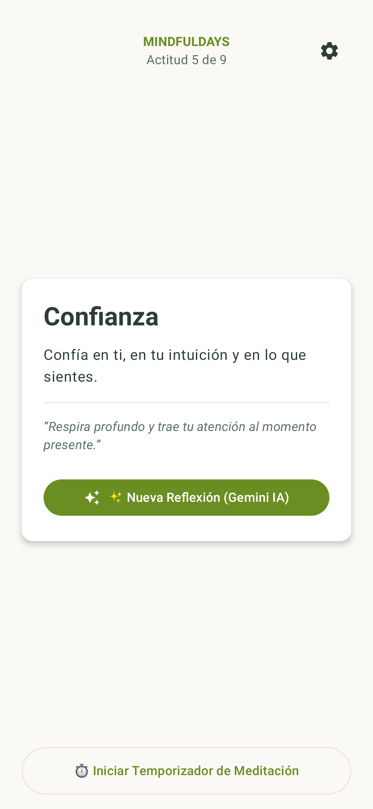
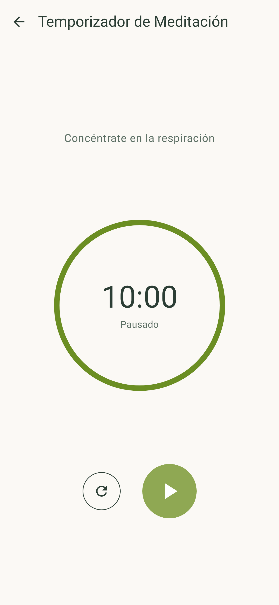
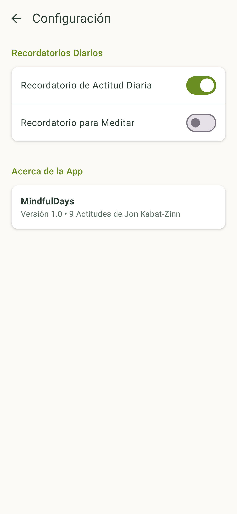
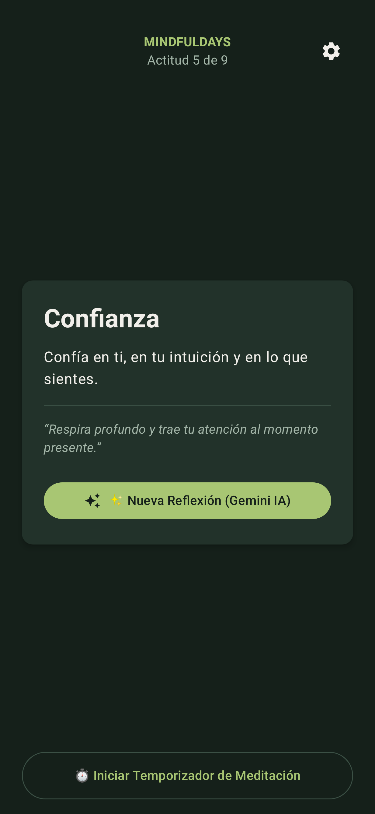
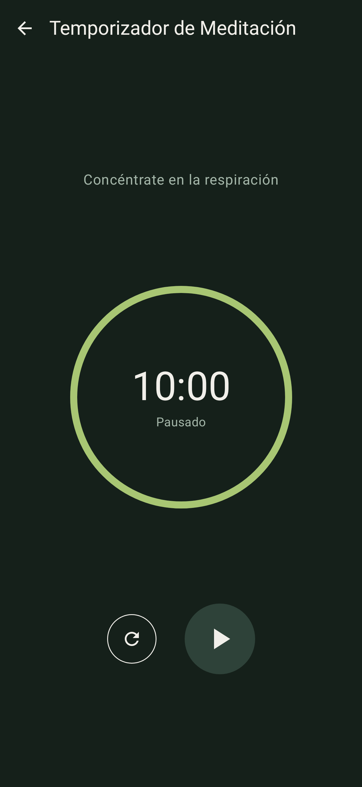
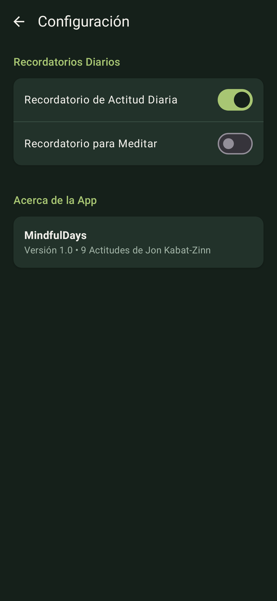

# 🧘 MindfulDays

App Android de mindfulness construida siguiendo el workshop
[angelica-oliv/mindfuldays-workshop](https://github.com/angelica-oliv/mindfuldays-workshop)
(Jetpack Compose + Material 3 + Gemini API).

- **Actitud del día**: una de las 9 actitudes de Jon Kabat-Zinn, según el día del año.
- **Reflexión con Gemini**: genera una reflexión corta en el idioma del teléfono (es / pt / en).
- **Temporizador de meditación** de 10 minutos con anillo circular y sonido al terminar.
- **Configuración** con recordatorios y modo claro / oscuro.

## Capturas

| Inicio | Temporizador | Configuración |
| :---: | :---: | :---: |
|  |  |  |
|  |  |  |

> Capturas generadas con Robolectric + Roborazzi (`ScreenshotsTest`), sin emulador.

## Cómo correrla

1. Abrir la carpeta en Android Studio y esperar el Gradle Sync.
2. Para activar Gemini, agregar la clave de [Google AI Studio](https://aistudio.google.com/apikey) en `local.properties`
   (este archivo no se sube a GitHub):
   ```properties
   GEMINI_API_KEY=tu_clave_aqui
   ```
   Sin clave la app funciona igual y muestra una reflexión sin conexión.
3. Run ▶ en un emulador o celular (Android 7.0+).

## Pruebas

```bash
./gradlew testDebugUnitTest          # reglas de las 9 actitudes + capturas
./gradlew connectedDebugAndroidTest  # Robot Pattern (necesita emulador o celular)
```
